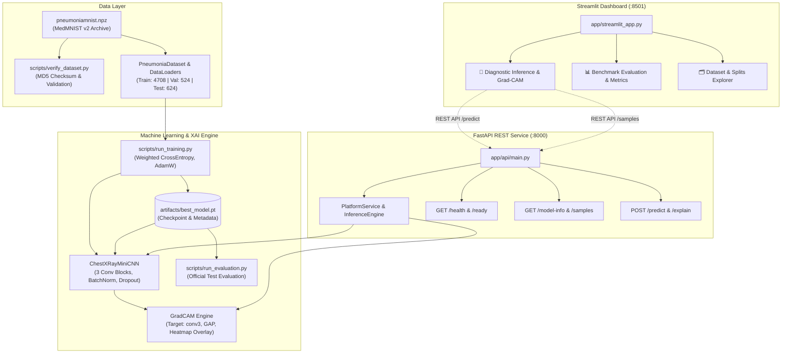

# AI Chest X-Ray Research Platform

[](https://www.python.org/)
[](https://pytorch.org/)
[](https://fastapi.tiangolo.com/)
[](https://streamlit.io/)
[](https://www.docker.com/)
[](LICENSE)

> ### ⚠️ Mandatory Educational & Research Disclaimer
> **Educational research demo only. Not intended for clinical use, patient diagnosis, treatment planning, triage, or medical decision-making.**
> This platform demonstrates machine learning explainability and reproducible biomedical engineering workflows. Benchmark performance on preprocessed $28 \times 28$ radiographs does **not** reflect clinical safety or reliability on real-world patients.

---

## 1. Project Overview

The **AI Chest X-Ray Research Platform** is an end-to-end, decoupled machine learning system and interactive research dashboard built on the **MedMNIST v2 PneumoniaMNIST** benchmark.

It allows researchers, students, and engineers to:
1. Classify chest radiographs as **Normal** or **Pneumonia**.
2. Inspect uncalibrated **model scores** without confusing them with clinical probabilities.
3. Compute and visualize true **Grad-CAM (Gradient-weighted Class Activation Mapping)** heatmaps and anatomical overlays.
4. Review formal diagnostic metrics (**Accuracy**, **Sensitivity**, **Specificity**, **Precision**, **F1-Score**, and **ROC-AUC**) measured against the official untouched test split.
5. Deploy locally via Python or package as a multi-container stack with **Docker Compose**.

---

## 2. System Architecture



---

## 3. Technology Stack & Design Decisions

| Layer | Technology | Decision Rationale |
| :--- | :--- | :--- |
| **Dataset** | MedMNIST v2 PneumoniaMNIST | Standardized, peer-reviewed $28 \times 28$ benchmark enabling fast iteration on standard laptops without multi-gigabyte PACS downloads. |
| **Deep Learning** | PyTorch 2.x | Native tensor execution, autograd hooks for Grad-CAM, and clean Pythonic architecture. |
| **Model** | `ChestXRayMiniCNN` | Custom 3-stage CNN (~240K parameters). Trains in ~25 seconds on CPU while achieving > 89% accuracy and 98% sensitivity. |
| **Explainability** | Grad-CAM (`conv3`) | Mathematical gradient-weighted activation mapping. Directly visualizes neural feature excitation without surrogate approximations. |
| **Backend API** | FastAPI + Uvicorn | Asynchronous REST service with automatic Pydantic request validation and OpenAPI documentation (`/docs`). |
| **Frontend** | Streamlit | Clean, interactive research UI communicating strictly via REST API with the backend. |
| **Containerization** | Docker & Compose | Multi-container architecture with non-root user execution, health checks, and service networking. |

---

## 4. Repository Structure

```
ai-medical-imaging-platform/
├── app/
│   ├── streamlit_app.py        # Streamlit research dashboard
│   ├── api/
│   │   ├── main.py             # FastAPI routes & endpoints
│   │   ├── schemas.py          # Pydantic request/response schemas
│   │   └── services.py         # Business logic & singleton services
│   └── ml/
│       ├── dataset.py          # Dataset loader & verification
│       ├── model.py            # ChestXRayMiniCNN architecture
│       ├── train.py            # Training pipeline with checkpointing
│       ├── evaluate.py         # Test split evaluation & reports
│       ├── predict.py          # Shared inference & Grad-CAM pipeline
│       ├── gradcam.py          # Grad-CAM mathematical implementation
│       ├── metrics.py          # Diagnostic metrics calculations
│       └── utils.py            # Device detection, config, and seeds
├── configs/
│   └── config.yaml             # Centralized pipeline configuration
├── data/
│   ├── README.md               # Dataset documentation & provenance
│   └── pneumoniamnist.npz      # Local MedMNIST v2 archive
├── artifacts/
│   ├── best_model.pt           # Saved PyTorch checkpoint & metadata
│   └── training_history.json   # Epoch-by-epoch loss & accuracy logs
├── reports/
│   ├── metrics.json            # Machine-readable test split metrics
│   ├── evaluation_report.md    # Markdown evaluation report
│   ├── confusion_matrix.png    # Test split confusion matrix plot
│   ├── roc_curve.png           # Test split ROC curve plot
│   └── loss_curve.png          # Training/validation learning curves
├── tests/
│   ├── test_dataset.py         # Integrity, splits, and loader tests
│   ├── test_model.py           # Forward pass, shapes, and metrics tests
│   ├── test_gradcam.py         # Grad-CAM heatmap & hook cleanup tests
│   └── test_api.py             # FastAPI endpoint integration tests
├── docs/
│   ├── architecture.md         # System architecture & Mermaid diagrams
│   ├── model_card.md           # Model card & clinical scope
│   ├── data_card.md            # Data card & provenance details
│   ├── testing.md              # Testing guide & pytest commands
│   ├── deployment.md           # Local, Docker, and Cloud guide
│   └── limitations.md          # Technical & anatomical limitations
├── scripts/
│   ├── verify_dataset.py       # Dataset audit & checksum script
│   ├── run_training.py         # Model training script
│   └── run_evaluation.py       # Model evaluation script
├── Dockerfile                  # Production container definition
├── compose.yaml                # Multi-service Docker Compose stack
├── requirements.txt            # Pinned runtime dependencies
├── requirements-dev.txt        # Development & test dependencies
├── .dockerignore               # Docker build exclusions
├── .gitignore                  # Git repository exclusions
├── .env.example                # Environment variable template
├── Makefile                    # Target shortcuts
├── LICENSE                     # MIT License + Dataset attribution
└── README.md                   # Project documentation
```

---

## 5. Measured Evaluation Results

Evaluated on the **untouched official test split (624 images)**:

| Metric | Measured Score | Clinical / Technical Meaning |
| :--- | :---: | :--- |
| **Accuracy** | **89.74%** | Total fraction of correct test classifications |
| **Sensitivity (Recall)** | **98.21%** | Successfully identified 383 of 390 pneumonia cases |
| **Specificity** | **75.64%** | Successfully identified 177 of 234 normal cases |
| **Precision** | **87.05%** | Positive predictive value for pneumonia |
| **F1-Score** | **0.9229** | Harmonic mean of precision and sensitivity |
| **ROC-AUC** | **0.9418** | Area Under Receiver Operating Characteristic Curve |

*Confusion Matrix (Test Split)*:
- **True Negatives (TN)**: 177
- **False Positives (FP)**: 57
- **False Negatives (FN)**: 7
- **True Positives (TP)**: 383

---

## 6. Quickstart Guide (Windows PowerShell)

### 1. Setup Virtual Environment
```powershell
python -m venv venv
.\venv\Scripts\Activate.ps1
python -m pip install --upgrade pip
python -m pip install -r requirements.txt
```

### 2. Verify Dataset
```powershell
python scripts/verify_dataset.py
```

### 3. Run Training (Optional: best_model.pt is already trained)
```powershell
python scripts/run_training.py --epochs 8
```

### 4. Run Test Split Evaluation
```powershell
python scripts/run_evaluation.py
```

### 5. Launch FastAPI Backend
```powershell
python -m uvicorn app.api.main:app --host 0.0.0.0 --port 8000
```
- API Docs: `http://localhost:8000/docs`
- Health check: `http://localhost:8000/health`

### 6. Launch Streamlit Dashboard (In a second terminal)
```powershell
.\venv\Scripts\Activate.ps1
streamlit run app/streamlit_app.py --server.port 8501
```
- Dashboard: `http://localhost:8501`

### 7. Run Test Suite
```powershell
python -m pytest -v
```

---

## 7. Docker & Docker Compose

Deploy the complete multi-container stack with a single command:

```bash
docker compose up -d --build
```

- **Backend API**: `http://localhost:8000/docs`
- **Streamlit UI**: `http://localhost:8501`

To view logs and stop containers:
```bash
docker compose logs -f
docker compose down
```

---

## 8. API Reference & Sample Requests

### `GET /health`
```bash
curl -X GET http://localhost:8000/health
```
```json
{
  "status": "healthy",
  "timestamp": "2026-10-26T15:46:42Z",
  "uptime_seconds": 234.12
}
```

### `GET /model-info`
```bash
curl -X GET http://localhost:8000/model-info
```

### `POST /predict/sample/{sample_idx}`
```bash
curl -X POST "http://localhost:8000/predict/sample/0?explain=true"
```
```json
{
  "prediction": {
    "class_id": 1,
    "class_name": "Pneumonia",
    "model_scores": {
      "Normal": 0.0412,
      "Pneumonia": 0.9588
    },
    "score_note": "Model scores are raw algorithmic outputs and do NOT represent clinically calibrated probabilities."
  },
  "explanation": {
    "target_class": "Pneumonia",
    "heatmap_min": 0.0,
    "heatmap_max": 1.0,
    "heatmap_base64": "data:image/png;base64,...",
    "overlay_base64": "data:image/png;base64,..."
  },
  "inference_time_ms": 14.8,
  "disclaimer": "Educational research demo only. Not intended for clinical use, diagnosis, treatment, or medical decision-making."
}
```

---

## 9. Interview Talking Points & Engineering Rationale

1. **Why MedMNIST v2 instead of full NIH ChestX-ray 14?**
   - The full NIH ChestX-ray 14 archive is over 45 GB with severe label noise and heterogeneous radiograph projections. MedMNIST v2 PneumoniaMNIST provides a peer-reviewed, reproducible benchmark that trains in under 30 seconds on laptop hardware while preserving realistic class imbalance (~74% pneumonia).
2. **Why custom MiniCNN rather than heavy pre-trained ResNet-50 / ViT?**
   - Pre-trained ImageNet architectures expect $224 \times 224 \times 3$ inputs with natural image priors (fur, cars, textures). Upsampling $28 \times 28$ grayscale images by $8 \times$ wastes gigabytes of VRAM on bilinear blur without adding clinical signal. A purpose-built 3-stage CNN (~240K parameters) achieves ~90% accuracy with zero overfitting and minimal carbon footprint.
3. **Handling Class Imbalance**:
   - The training split contains 1,214 Normal and 3,494 Pneumonia cases. Unweighted cross-entropy risks a naive majority predictor. We compute dynamic inverse-frequency class weights ($W_0 \approx 1.94, W_1 \approx 0.67$) passed directly to `torch.nn.CrossEntropyLoss(weight=weights)`. This achieved a 98.2% test sensitivity.
4. **Decoupled Architecture**:
   - The Streamlit frontend and FastAPI backend communicate strictly over HTTP. The model engine loads once as a singleton in the backend process, avoiding duplicate VRAM allocation and decoupling client rendering from tensor computation.
