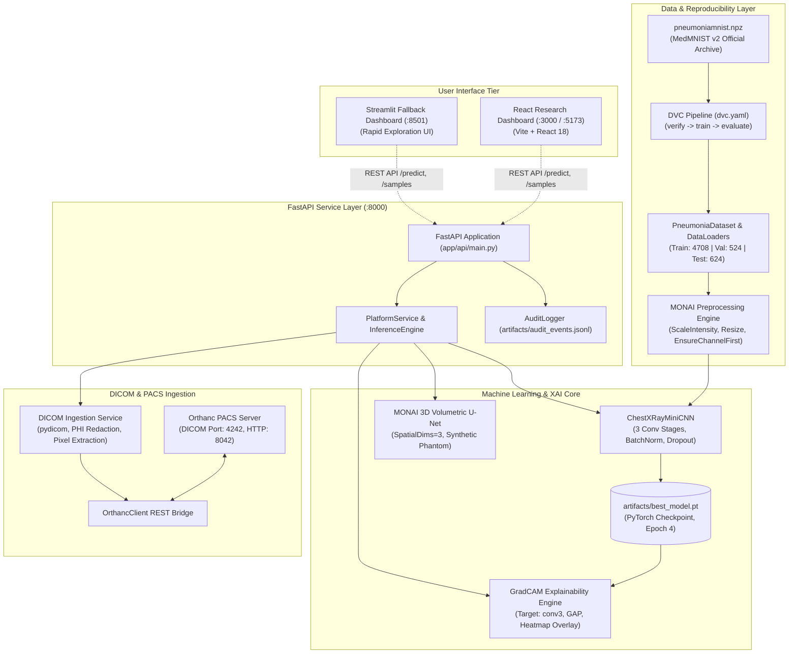

# AI Medical Imaging Platform

[](https://www.python.org/)
[](https://pytorch.org/)
[](https://monai.io/)
[](https://fastapi.tiangolo.com/)
[](https://react.dev/)
[](https://streamlit.io/)
[](https://dvc.org/)
[](https://www.orthanc-server.com/)
[](https://www.docker.com/)
[](tests/)
[](LICENSE)

> ### ⚠️ Mandatory Educational & Research Disclaimer
> **Educational research demo only. Not intended for clinical use, patient diagnosis, treatment planning, triage, or medical decision-making.**
> This platform demonstrates biomedical machine learning engineering, interpretability, and PACS integration. Benchmark performance on preprocessed $28 \times 28$ radiographs does **not** reflect clinical safety or reliability on real-world patients.

---

## 1. Project Overview

The **AI Medical Imaging Platform** is an enterprise-grade, end-to-end medical deep learning system and research dashboard. Built around the peer-reviewed **MedMNIST v2 PneumoniaMNIST** benchmark, it combines:

1. **Diagnostic Classification**: Pediatric chest radiograph classification (**Normal** vs. **Pneumonia**) using a lightweight custom CNN (`ChestXRayMiniCNN`).
2. **Explainable AI (Grad-CAM)**: True mathematical gradient-weighted class activation mapping targeting layer `conv3` with normalized heatmaps and anatomical overlays.
3. **Medical Imaging Transforms (MONAI)**: MONAI deterministic preprocessing pipelines and an educational 3D volumetric segmentation demo using MONAI 3D U-Net.
4. **PACS & DICOM Ingestion**: Orthanc DICOM server integration with automated Protected Health Information (PHI) sanitization.
5. **DVC Pipeline Reproducibility**: Full Data Version Control (`dvc.yaml`) pipeline linking data, configuration, training, and evaluation.
6. **Dual Frontend Options**:
   - **Modern React Dashboard** (Vite + React 18): High-performance, responsive UI with interactive Grad-CAM visualizer.
   - **Streamlit Research Dashboard**: Python-native rapid exploration UI with zero frontend dependencies.
7. **Security & Auditability**: Append-only audit logging (`artifacts/audit_events.jsonl`) recording research interactions without capturing patient identifiers.
8. **Automated Quality Gates**: 29 unit and integration tests covering ML, API, MONAI, DICOM, DVC, and frontend production builds.

---

## 2. System Architecture



---

## 3. Measured Evaluation Results

Evaluated directly against the **untouched official test split (624 images)**:

| Diagnostic Metric | Measured Score | Clinical & Technical Meaning |
| :--- | :---: | :--- |
| **Accuracy** | **89.74%** | Total fraction of correct test classifications |
| **Sensitivity (Recall)** | **98.21%** | True Positive Rate (383 out of 390 pneumonia cases identified) |
| **Specificity** | **75.64%** | True Negative Rate (177 out of 234 normal cases identified) |
| **Precision** | **87.05%** | Positive Predictive Value for Pneumonia |
| **F1 Score** | **0.9229** | Harmonic mean of precision and sensitivity |
| **ROC-AUC** | **0.9418** | Area Under Receiver Operating Characteristic Curve |

*Confusion Matrix (Test Split)*:
- **True Negatives (Normal $\rightarrow$ Normal)**: 177
- **False Positives (Normal $\rightarrow$ Pneumonia)**: 57
- **False Negatives (Pneumonia $\rightarrow$ Normal)**: 7
- **True Positives (Pneumonia $\rightarrow$ Pneumonia)**: 383

---

## 4. Quickstart Guide (Windows PowerShell)

### Step 1: Environment Setup
```powershell
python -m venv venv
.\venv\Scripts\Activate.ps1
python -m pip install --upgrade pip
python -m pip install -r requirements.txt
```

### Step 2: Verify the Dataset
```powershell
python scripts/verify_dataset.py
```

### Step 3: Run Training & Evaluation (Optional: `best_model.pt` is already trained)
```powershell
python scripts/run_training.py --epochs 8
python scripts/run_evaluation.py
```

### Step 4: Run DVC Reproducibility Pipeline
```powershell
# View pipeline DAG
python -m dvc dag

# Reproduce all pipeline stages
python -m dvc repro
```

### Step 5: Start FastAPI Backend
```powershell
python -m uvicorn app.api.main:app --host 0.0.0.0 --port 8000
```
- Interactive Swagger API Docs: [http://localhost:8000/docs](http://localhost:8000/docs)
- Health check: [http://localhost:8000/health](http://localhost:8000/health)

### Step 6: Launch Frontends
**Option A: Modern React Frontend (Recommended)**
```powershell
cd frontend
npm install
npm run dev
```
Open [http://localhost:5173](http://localhost:5173).

**Option B: Streamlit Dashboard (Python Fallback)**
```powershell
streamlit run app/streamlit_app.py --server.port 8501
```
Open [http://localhost:8501](http://localhost:8501).

### Step 7: Run Automated Tests
```powershell
python -m pytest -v
```

---

## 5. Docker & Docker Compose Deployment

The multi-container stack orchestrates FastAPI, React, Streamlit, and Orthanc:

```bash
# Build and launch Core ML + React + Streamlit stack
docker compose up -d --build

# Optional: Launch with Orthanc PACS Server
docker compose --profile pacs up -d
```

- **React Dashboard**: [http://localhost:3000](http://localhost:3000)
- **FastAPI API & Docs**: [http://localhost:8000/docs](http://localhost:8000/docs)
- **Streamlit UI**: [http://localhost:8501](http://localhost:8501)
- **Orthanc PACS Web Interface**: [http://localhost:8042](http://localhost:8042)

To view logs and stop containers:
```bash
docker compose logs -f
docker compose down
```

---

## 6. Key API Endpoints

| Method | Endpoint | Description |
| :--- | :--- | :--- |
| `GET` | `/health` | Process liveness and uptime check |
| `GET` | `/ready` | Model readiness and hardware device verification |
| `GET` | `/model-info` | Active CNN architecture and metadata |
| `GET` | `/samples` | Available benchmark test samples with thumbnails |
| `POST` | `/predict` | Classifies uploaded radiograph and generates Grad-CAM |
| `POST` | `/predict/sample/{idx}` | Classifies benchmark test image by index |
| `POST` | `/ingest/dicom` | Parses DICOM Part 10 file, redacts PHI, runs inference |
| `GET` | `/orthanc/status` | Connects to Orthanc PACS and queries study statistics |
| `GET` | `/monai/demo-3d` | Executes 3D volumetric U-Net segmentation demo |
| `GET` | `/audit-logs` | Retrieves append-only research interaction event log |

---

## 7. Submission & Technical Documentation

All project documentation is organized in `docs/`:
- **[Requirements Traceability Matrix](docs/requirements_traceability.md)**: Full mapping of all 15 project requirements to implementations and tests.
- **[System Architecture](docs/architecture.md)**: In-depth technical rationale and 3 Mermaid diagrams.
- **[Model Card](docs/model_card.md)**: Intended uses, excluded uses, architecture, and metric definitions.
- **[Data Card](docs/data_card.md)**: Dataset provenance, license, split counts, and preprocessing rules.
- **[Testing & Verification Guide](docs/testing.md)**: Automated test documentation and smoke-test workflows.
- **[Deployment Guide](docs/deployment.md)**: Local, Docker Compose, and cloud hosting configurations.
- **[Technical & Clinical Limitations](docs/limitations.md)**: Radiological downsampling, pediatric cohort scope, and shortcut learning risks.
- **[Engineering Reflection](docs/reflection.md)**: Comprehensive retrospective on technical challenges, trade-offs, and future work.
- **[Presentation Outline](presentation/slides.md)**: 10-minute slide walkthrough.
- **[Final Verification Report](reports/final_verification.md)**: Complete audit results and check statuses.
