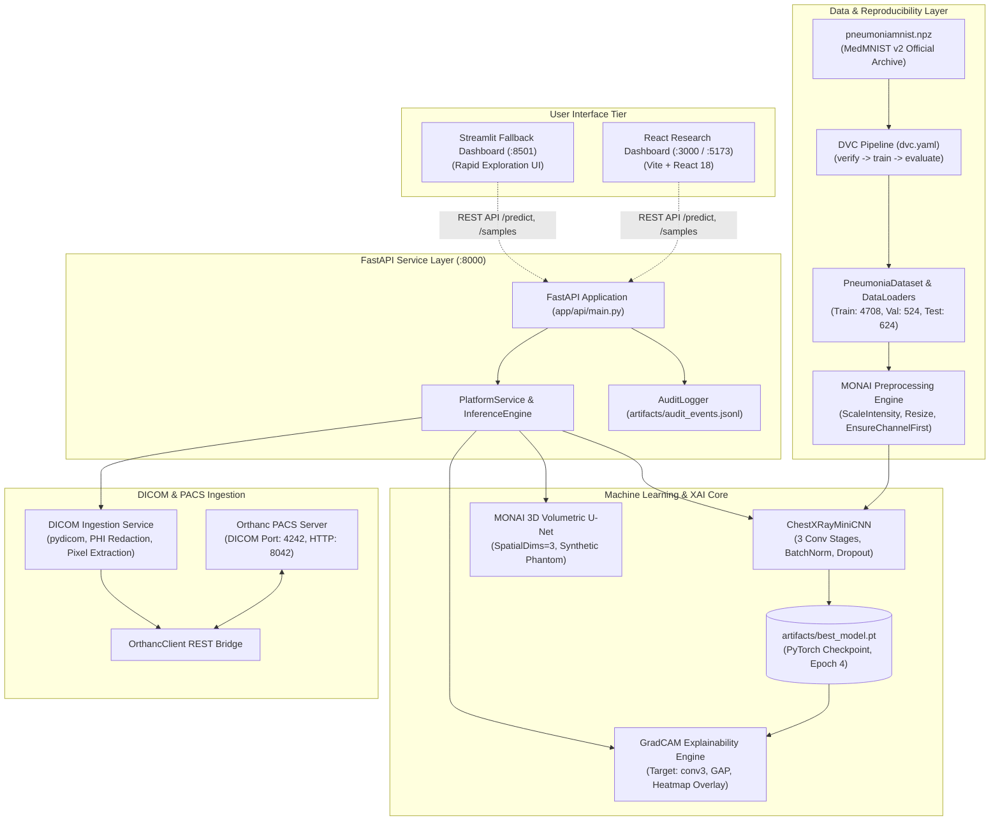
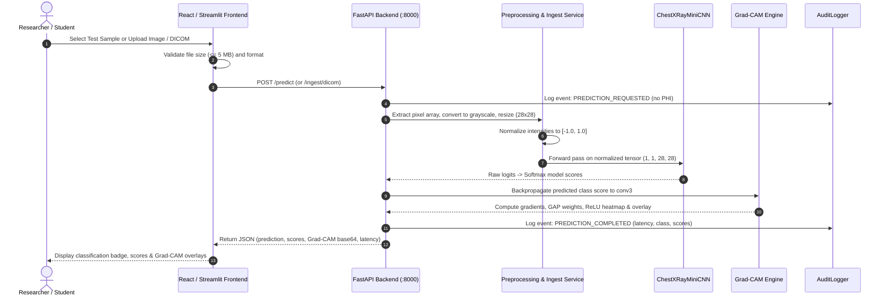
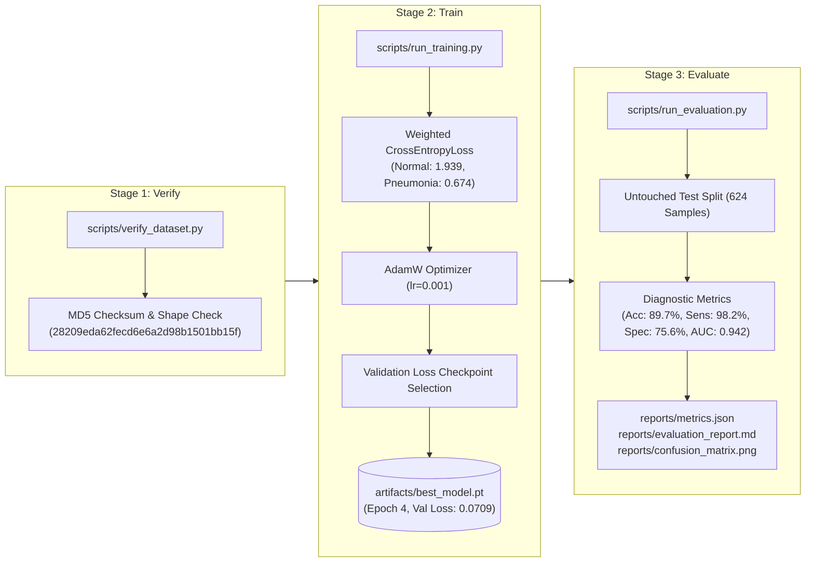

# AI Medical Imaging Platform — Architecture

## 1. System Overview

The **AI Medical Imaging Platform** is an enterprise-grade, modular biomedical research system integrating deep learning, explainability (Grad-CAM), MONAI medical image transforms, Orthanc PACS DICOM workflows, DVC reproducibility, and dual frontends (Modern React + Streamlit fallback).

---

## 2. Mermaid Architecture Diagrams

### Diagram 1: Comprehensive System Architecture

---

### Diagram 2: Image Ingestion and Inference Workflow

---

### Diagram 3: Training, Validation, and Evaluation Pipeline

---

## 3. Technology Stack & Design Decisions

| Technology | Role | Justification |
| :--- | :--- | :--- |
| **PyTorch 2.x** | Core Deep Learning | Native autograd hooks for Grad-CAM, device agnostic execution (CUDA/CPU). |
| **MONAI 1.6+** | Medical Preprocessing | Standardized healthcare imaging transforms, deterministic pipeline, 3D volumetric U-Net support. |
| **Orthanc PACS** | DICOM Storage & Ingestion | Standard open-source vendor-neutral DICOM PACS server with REST API. |
| **DVC 3.6+** | ML Reproducibility | Tracks dataset lineage and training stages without polluting Git with multi-megabyte binary checkpoints. |
| **FastAPI** | REST API Backend | High performance asynchronous Python web framework with typed Pydantic validation. |
| **React 18 + Vite** | Primary Frontend | Production-ready, lightning-fast component dashboard with responsive state management. |
| **Streamlit** | Fallback Frontend | Immediate pythonic UI providing seamless exploration if Node is unavailable. |
| **Docker Compose** | Deployment & Packaging | Multi-container profile architecture (`api`, `frontend`, `streamlit`, `orthanc`). |
