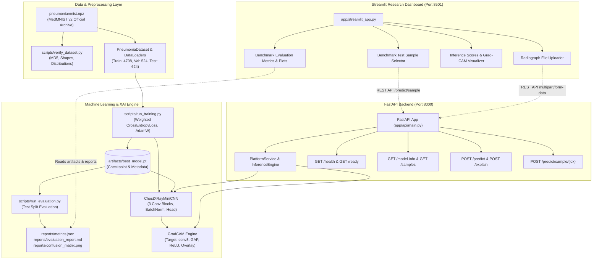

# AI Chest X-Ray Research Platform — Architecture

## 1. System Overview

The **AI Chest X-Ray Research Platform** is a decoupled, modular machine learning and web application designed for pedagogical research in deep learning and explainable AI (XAI) applied to chest radiography.

---

## 2. Component Design & Rationale

| Component | Technology | Rationale |
| :--- | :--- | :--- |
| **Dataset** | MedMNIST v2 PneumoniaMNIST | Standardized, peer-reviewed 28x28 benchmark allowing fast, reproducible research on laptop hardware without downloading multi-gigabyte clinical PACS archives. |
| **ML Framework** | PyTorch 2.x | Native tensor computations, dynamic autograd hooks for Grad-CAM, and clean Pythonic architecture. |
| **Model** | `ChestXRayMiniCNN` | Custom 3-stage CNN (~240K parameters) tailored for 28x28 single-channel radiographs. Trains in < 30 seconds on CPU while yielding > 89% accuracy and 98% sensitivity. |
| **Explainability** | Grad-CAM (Target: `conv3`) | Direct gradient-weighted activation mapping. Highlights semantic regions driving neural decisions without approximations or perturbation noise. |
| **Backend** | FastAPI + Uvicorn | High-throughput asynchronous REST API with automatic Pydantic request validation and OpenAPI documentation (`/docs`). |
| **Frontend** | Streamlit | Rapid, responsive data science dashboard communicating strictly through the REST API layer. Decoupled from backend execution. |
| **Containerization** | Docker & Docker Compose | Multi-container architecture with non-root security, health checks, and isolated service networking. |

---

## 3. Data Flow

1. **Client Request**:
   - The user selects a test sample or uploads a grayscale/RGB radiograph through the Streamlit dashboard or raw REST client.
2. **Payload Validation**:
   - FastAPI enforces a 5 MB payload limit, verifies MIME type, decodes image bytes, and ensures proper format.
3. **Preprocessing**:
   - The image is converted to single-channel 8-bit grayscale (`PIL.Image.convert('L')`), resized to `28x28` via bilinear interpolation, converted to `torch.float32`, and normalized:
     $$x_{\text{norm}} = \frac{\frac{x}{255.0} - 0.5}{0.5} \in [-1.0, 1.0]$$
4. **Inference**:
   - In `torch.no_grad()` mode, `ChestXRayMiniCNN` generates raw logits:
     $$\mathbf{z} = [z_0, z_1]$$
   - Numerically stable softmax produces model scores:
     $$s_c = \frac{e^{z_c}}{\sum_{j} e^{z_j}}$$
5. **Grad-CAM Computation**:
   - Forward hook records activation feature maps $A^k$ at layer `conv3`.
   - Backward pass on predicted class logit calculates gradients $\frac{\partial z_c}{\partial A^k}$.
   - Global Average Pooling produces importance weights $\alpha_k^c$.
   - Rectified combination yields 2D heatmap $L^c = \text{ReLU}\left(\sum_k \alpha_k^c A^k\right)$.
   - Heatmap is normalized to $[0, 1]$, upscaled to $28 \times 28$, colormapped (`jet`), and alpha-blended with the grayscale anatomy.
6. **Response Dispatch**:
   - Prediction, model scores, inference latency, base64-encoded visual assets, and the mandatory clinical disclaimer are packaged in a typed JSON response.
